# Villa design references

Four studios. Studios 1, 2 and 4 (Instagram) are 3D renders; studio 3 shows built houses (real photos). Areas: designlink areas are the user's notes; Khatib areas are from the captions.
Files: `images/<studio>/` = one sheet per post (photos in order, or 12 evenly spaced video frames; read left→right, top→bottom). `captions.md` = designers' English captions. Full-size images and videos are in the zip bundles, not the repo.
Likes: Instagram often hides like counts from logged-out viewers; a count of 3 is very likely a placeholder, so ignore it.

## Studio 1: designlink (@designlink.ae, UAE, #DLdesigns) — pulled 2026-11-10

| Area | Project | Location | Plot / layout idea | Key features | Posted | Likes | Link |
|---|---|---|---|---|---|---|---|
| 360 m² | Misaki ("beautiful bloom", Japanese) | Al Suyooh, Sharjah | Corner plot; L-shape opening to the corner; big garden kept for future extension | Japanese-modern; deep timber canopies; reflecting pool at entrance; stepping-stone garden; warm dark interiors; double-height living | 2025-07-21 | 107 | instagram.com/reel/DMX-YTSpvBa |
| 460 m² | The Cove | Tilal City, Al Suyooh, Sharjah | Irregular plot, street on 3 sides; form follows plot; carved-out back "cove" under 1st-floor overhang = private family space | Patterned privacy screens; pool + outdoor lounge; balcony planters; process diagrams (massing → concept → space experience); sun section | 2025-10-01 | – | instagram.com/reel/DPQ2ayliIHI |
| 490 m² (no basement) | not pulled | – | – | – | – | – | instagram.com/p/DcbN_UyiPMu |
| ? | not pulled | – | – | – | – | – | instagram.com/reel/DKHo4MFpAla |
| 550 m² | Nexus (Al-Maazmi villa) | Al Reeman, Abu Dhabi | Corner plot; house at back, faces front to catch cooling wind; large front family garden | Tall framed entrance; cypress trees; long street privacy screen; open plan with clear sight lines; wind-flow and floor-link 3D diagrams | 2024-09-15 | 43 | instagram.com/reel/C_8Gk4Kye5X |
| 600 m² | Eliorin (sun + rain; Al Khazraji villa) | Riyadh City, Abu Dhabi | Open indoor–outdoor connection; large open gardens | Rain-like vertical rod screens; inner courtyard with tree; wood slats + grey stone; minimal interiors | 2025-04-10 | – | instagram.com/reel/DIRLbMVJWWv |

Patterns: each project built on one named idea (name, logo, caption opening with an architect's quote); two storeys; street privacy screen; garden/pool at the centre; cream stone + warm wood + dark metal; reels go exterior → concept diagrams → interiors → logo. Shows design reasoning (wind, sun, plot shape, massing).
Not pulled: DcbN_UyiPMu and DKHo4MFpAla (Instagram needs login). To get them: screenshots/caption text, or a logged-in cookies file (user's call).

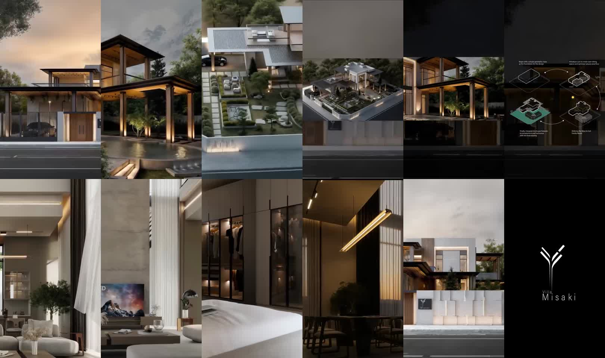
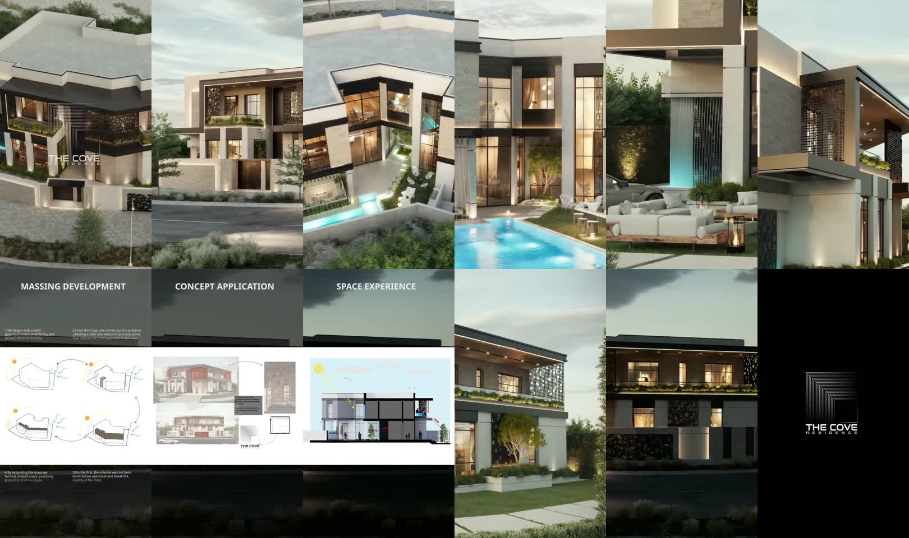
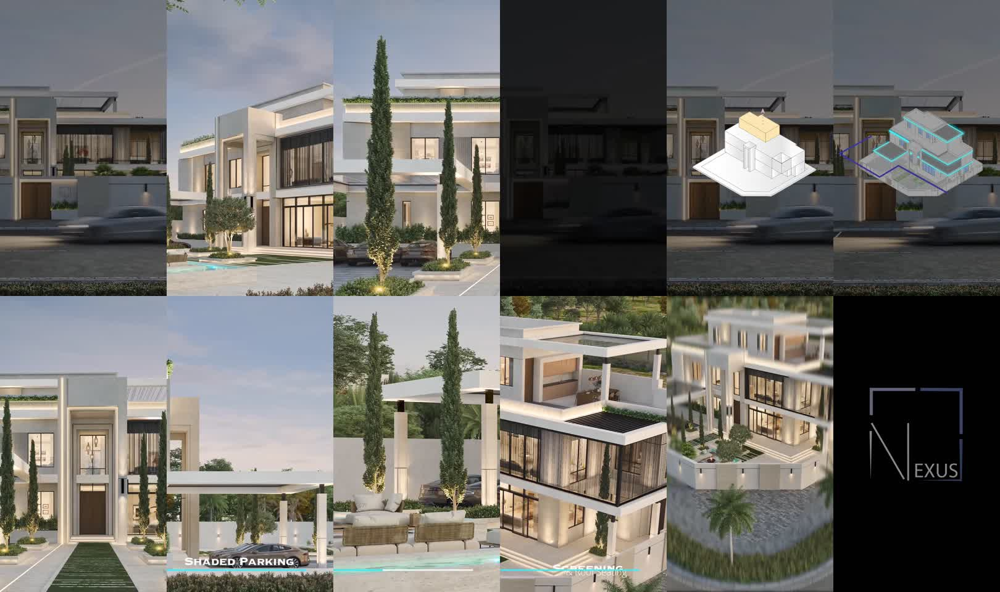
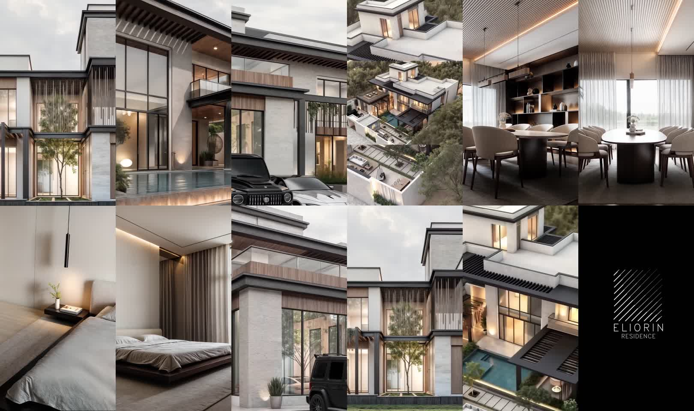

## Studio 2: Mohammad Khatib & his team (@mohammadkhatib.studio, Oman; Arabic name الخطيب للاستشارات الهندسية) — pulled 2026-11-12
Architecture + interior + landscape. All 10 posts pulled (52 photos, 4 videos).

| Area | Project | Location | Type | What it shows | Posted | Likes | Link |
|---|---|---|---|---|---|---|---|
| 320 m² | Villa Dawood | Muscat | Reel 82 s | Designer explains the plan on paper + 3D model: double-height entrance, majlis + multipurpose room on ground floor, 2 bedrooms on 1st floor, laundry/drying area, courtyard; focus on high privacy | 2026-09-05 | – | instagram.com/reel/Dc6SXsyNwPo |
| 400 m² | Muscat villa ("Architecture that speaks for itself") | Muscat | 8 photos | Curved-edge cream plaster walls, natural Omani stone cladding, wood entrance door, timber gate slats, back garden with reflecting water + outdoor lounge (materials labelled) | 2026-11-05 | – | instagram.com/p/DfXa72rjElK |
| 400 m² | Sur villa ("We design the way you live") | Sur, Oman | 12 photos | Day + night pairs; big perforated timber screen box on the façade; layered terraces with warm strip lighting; outdoor seating | 2026-08-19 | 187 | instagram.com/p/DcOnxk5jKnd |
| ? | Al Yaqoodan Villa | Muscat | 9 photos | Full package (architecture, interior, landscape) shown as a magazine: travertine façade, double-height living rooms, glass-framed entrance, bathroom, bedroom, pool at dusk | 2026-10-25 | – | instagram.com/p/De6-vGUjMDz |
| ? | "Pure Nature" | Saudi Arabia | 5 photos | Travertine panel façade, tall framed window, timber canopy, wood garage doors, high street wall | 2026-10-02 | – | instagram.com/p/Dd_pmkHjCXA |
| ? | Villa A225 ("Essence"; "language of contemporary luxury") | Al Mawaleh, Muscat | 5 photos + 4 s animated cover | Stone/travertine box, wide glazing, vertical wood slats, garage gate, planter + water strip by the drive, night view | 2026-09-18 | – | instagram.com/p/DdbmcPZDNQ8 |
| – | Omani-style façade, day vs night | – | Reel 10 s | Traditional Omani arches + carved openings in a modern villa; lighting design dusk to night | 2026-10-31 | – | instagram.com/reel/DfKbeAQSTHQ |
| – | Courtyard "planted boxes" | – | Reel 18 s | Inner courtyard: tree in a planter box surrounded by water, rough stone wall, ferns, uplights | 2026-09-16 | – | instagram.com/reel/DdWt-83tFo6 |
| – | Contemporary chalet | – | 6 photos | Rubble-stone arched volume with black-framed arched glazing, curved white walls, pergola walkway | 2026-06-11 | – | instagram.com/p/DZc5gCUDJDD |
| – | Interior ("Inspired by nature") | – | 7 photos | Floating timber stair over an indoor tree garden, stone feature wall, open living + kitchen, warm neutrals, linear lights | 2026-02-04 | – | instagram.com/p/DUVgswMjNVE |

Patterns: Omani/Gulf context; cream plaster + travertine/Omani stone + warm wood; strong privacy (high street walls, screens); courtyards, planters and water features; heavy night-lighting design; posts styled as marketing (title slide, "SWIPE", contact end card). Shows plans in only one post (Villa Dawood) — ask for plans and areas for the rest.

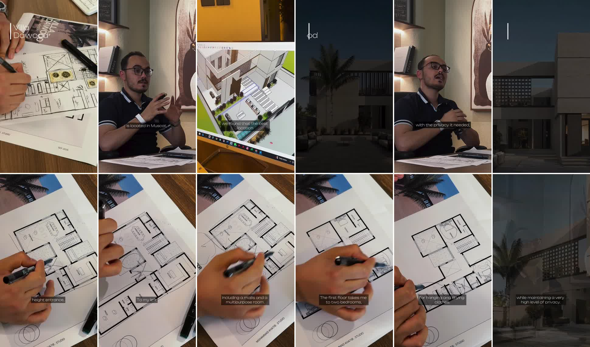
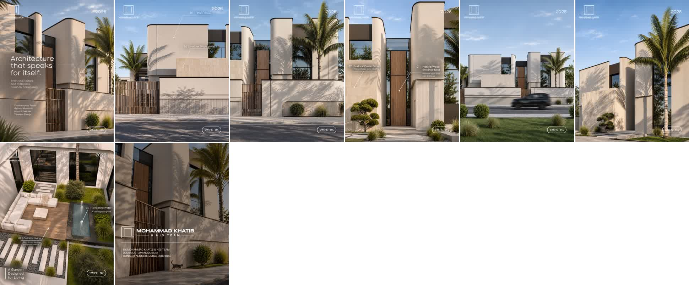
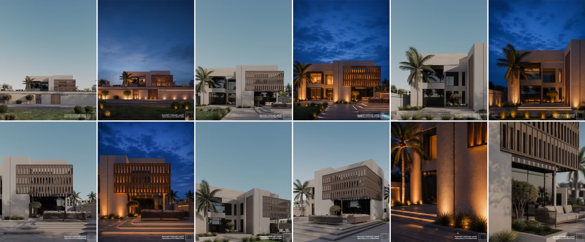
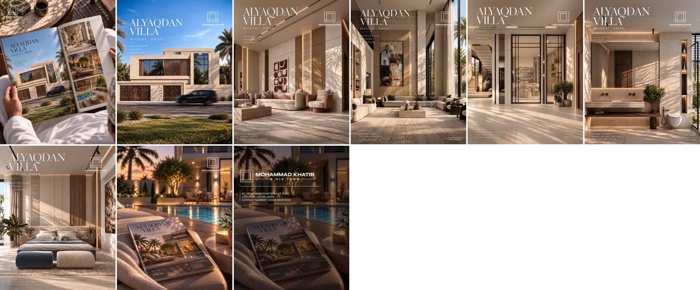
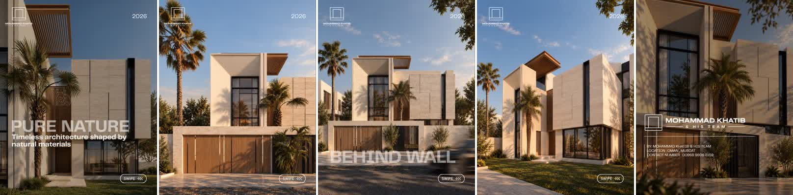
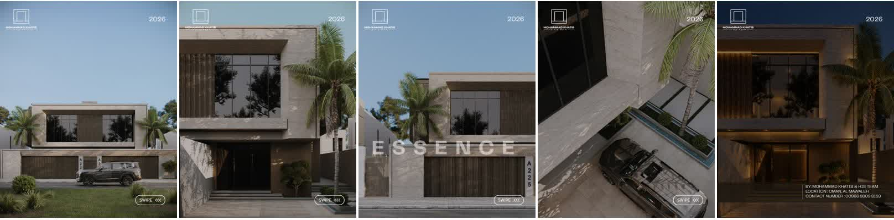
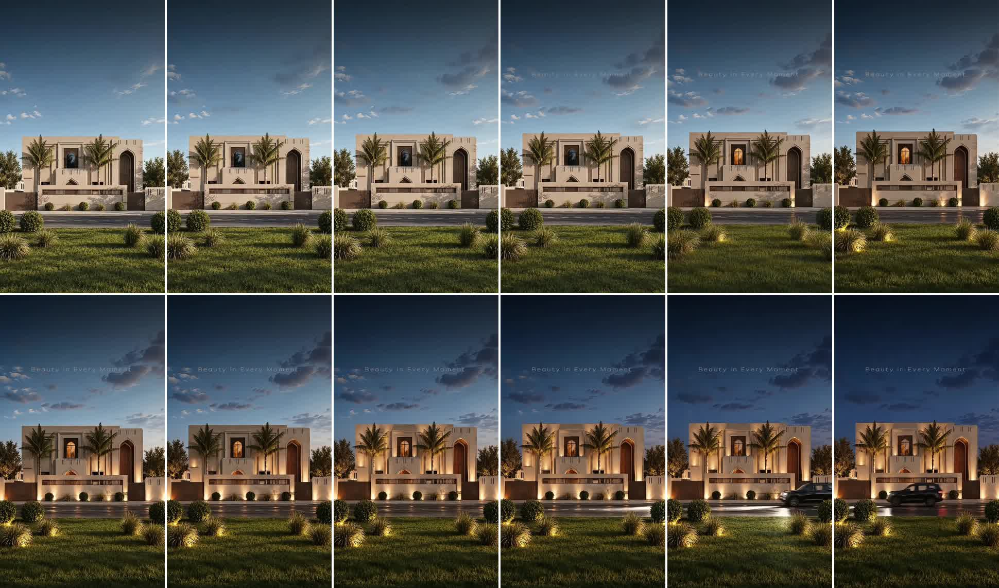
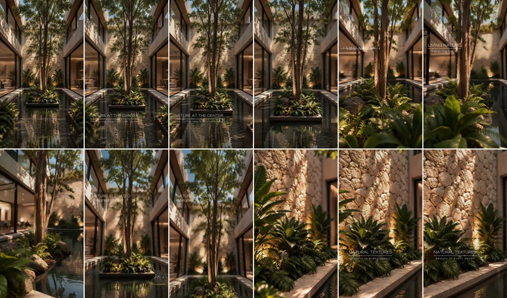
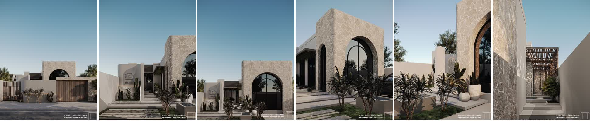
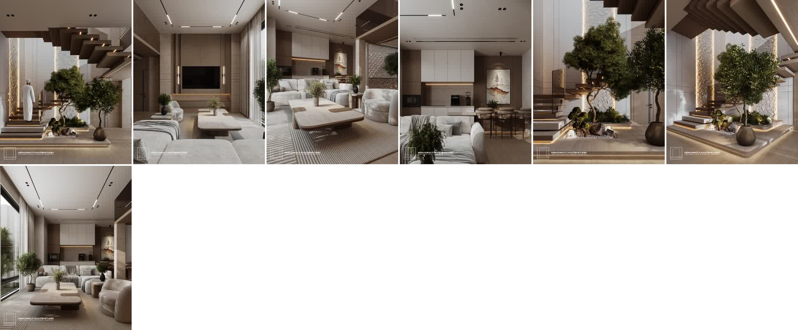

## Studio 3: Khammash Architects (khammash.com, Amman, Jordan) — pulled 2026-11-12

| Area | Project | Location | Type | What it shows | Year | Link |
|---|---|---|---|---|---|---|
| not stated | Fakhreddin House | Dabouq, Amman, Jordan | Built house, real photos (not renders) | Beige limestone cladding in large panels; deep cantilevered stone-clad roof over a wide timber deck; floor-to-ceiling sliding glass; cypress trees along a garden wall; vertical stone louvres; oak cantilevered stair with steel rail under a skylight | 2012 | khammash.com/projects/fakhreddin-house |
| not stated | Rifai House | New Badr, Amman | 3 photos | Traditional Levantine style: rough-cut local stone, arched loggias with cross vaults, olive tree at a paved entry court, bougainvillea and climbers, lawn and pool in front of the arches | 2007 | khammash.com/projects/rifai-house |
| not stated | Nuqul House | Abdoun, Amman | 2 photos | Large house in rusticated (rock-faced) limestone, stone arched gateway with wooden gates, rows of cypress, low flat-roofed volumes stepping back | 1996 | khammash.com/projects/nuqul-house |
| not stated | Bahrani House | Dabouq, Amman | 1 photo (two views) | Modern stacked limestone cubes with sawn-stone bands, deep-set windows, stone shelf details, planted front garden | 2006 | khammash.com/projects/bahrani-house |
| not stated | Pella House (architect's own house) | Pella, Jordan | 3 photos + full text | 3-storey house hugging a steep slope with no levelling of the ground; ceilings only 2.2 m to keep it small in the landscape; built by hand with no machinery on site (nearest vehicle 60 m away); precast blocks, mud plaster outside, white cement + lime inside; sits on a cave that supplied the materials. Warm earthy interior studio | 1994 | khammash.com/projects/pella-house |

All photos are real (built houses), full size 2000×955, plus small 246×246 thumbnails. On every project the site's Construction, Drawings and Sketches tabs are empty, and the PDF briefs leave Area blank. Only Pella House has a written description.
Patterns: local limestone used in very different ways (sawn modern cubes, rock-faced rustic, rough rubble with arches, mud plaster); cypress and olive trees; arches and vaulted loggias; houses fitted to the land.

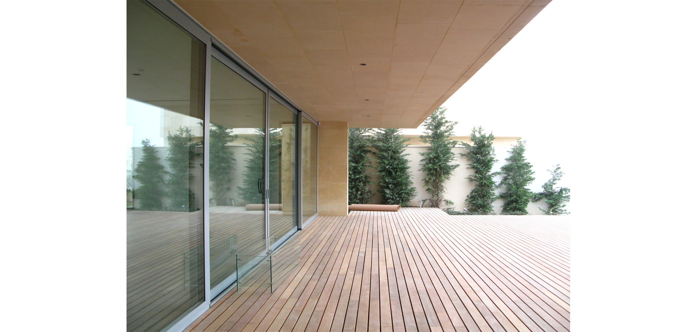
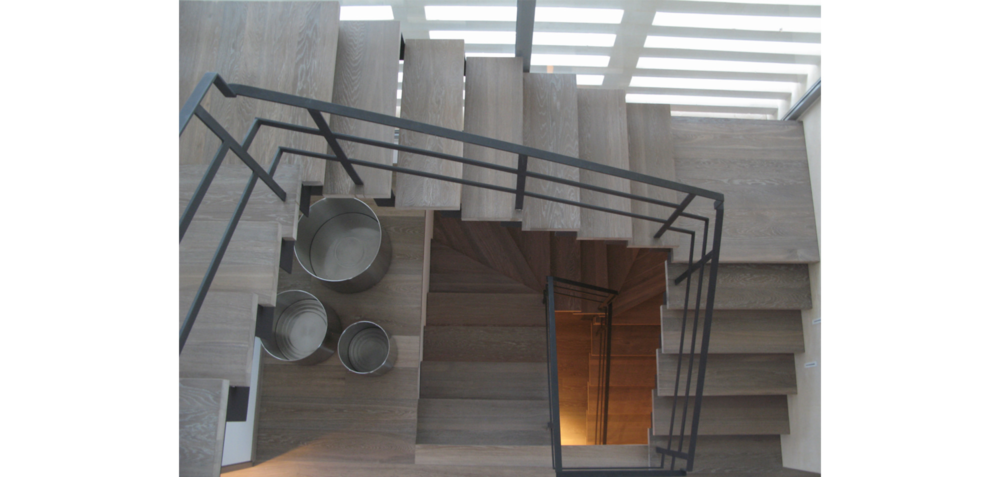
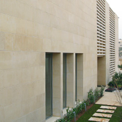
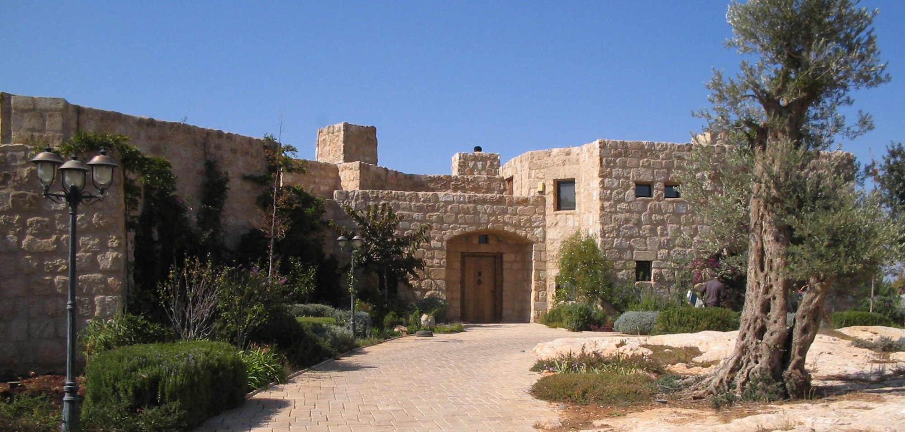
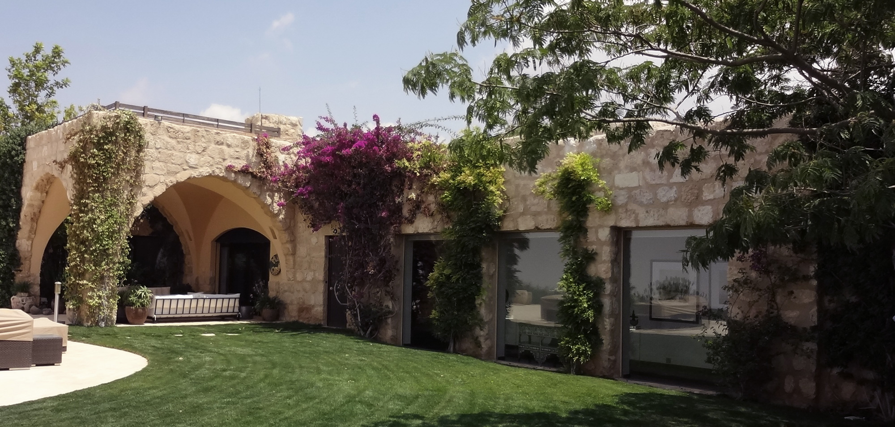
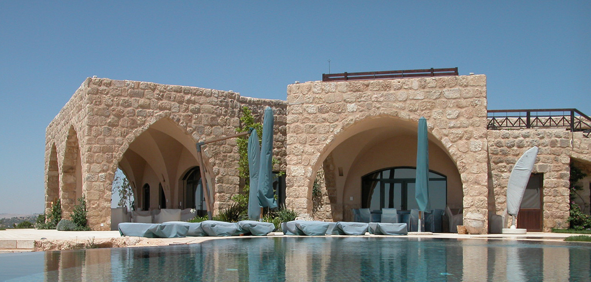
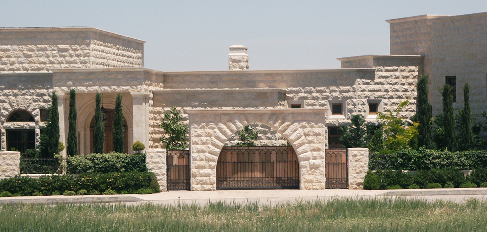
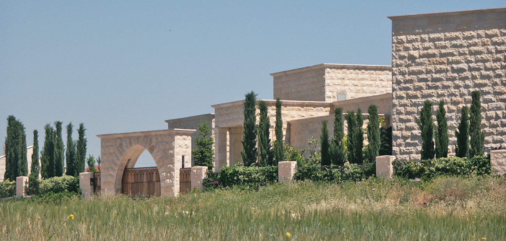
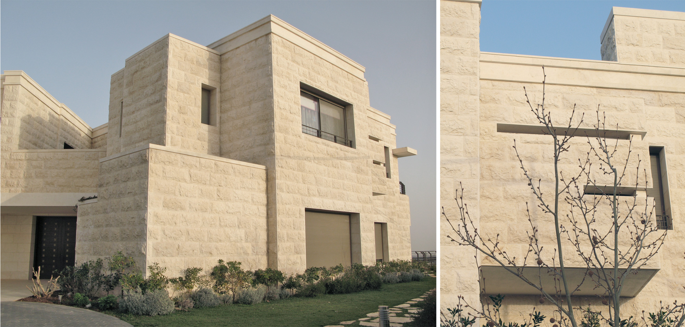
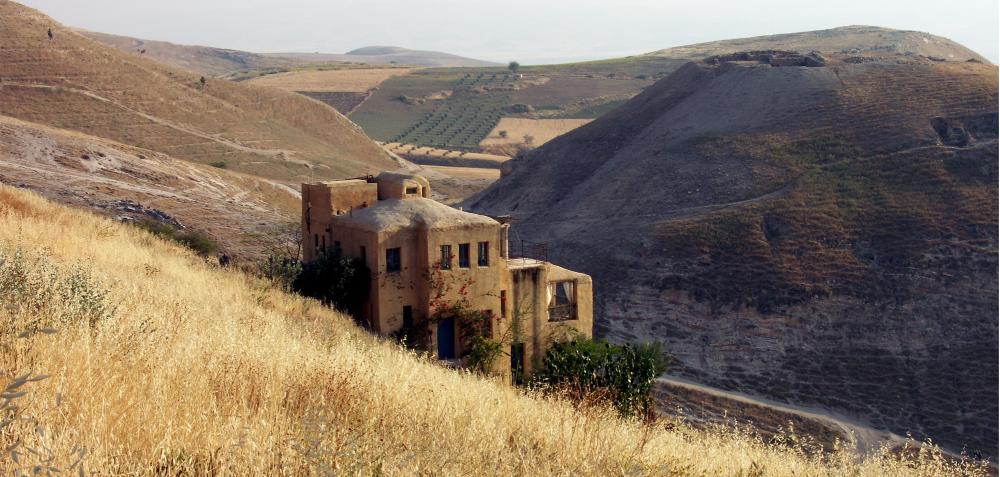
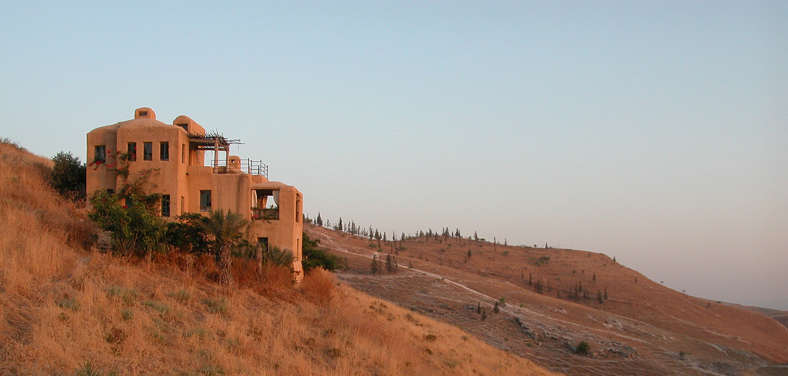
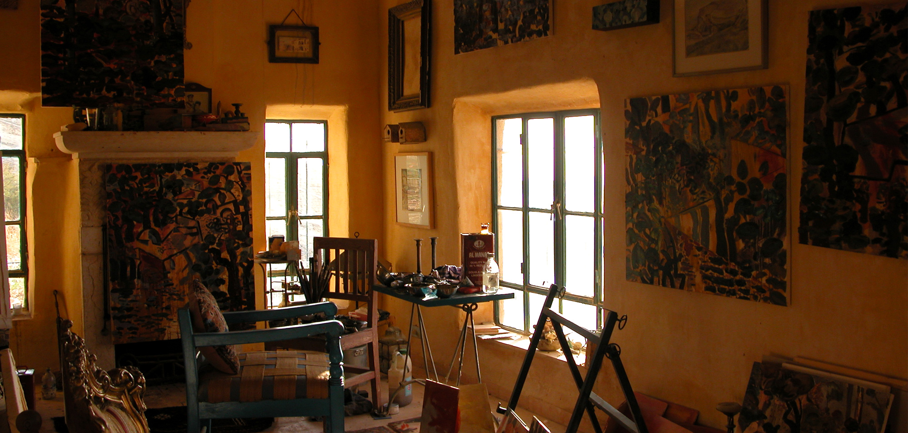

## Studio 4: Moqama مقامة (Kuwait; @diar.moqama company account, @moqama.kw) — pulled 2026-11-14
Architecture + interior design, all 3D renders except one site photo. Captions are in Arabic (summarised here). 12 posts, 82 photos, 2 reels. Their stated aim: spaces that belong to their place and people, keep local identity, meet modern life. Phone numbers are in captions; not copied here.

| Area | Project | Location | Type | What it shows | Posted | Likes | Link |
|---|---|---|---|---|---|---|---|
| 400 m² | Residential (architecture only) | not stated | 7 images | Day/night façade; white curved wall with a big arch and rust-red screen; round perforated blocks; cactus garden with lit paths | 2024-03-07 | – | instagram.com/p/C4Nw7LfMDS- |
| 400 m² | Built house, courtyard | not stated | 2 site photos | Real photos: bare block-work courtyard with arches and a square sky opening; caption quotes Hassan Fathy on the courtyard as an image of the cosmos | 2026-02-06 | 189 | instagram.com/p/DUbLYcfCJPr |
| ? | Villa with courtyards | not stated | 9 images | Cream limestone and perforated screens, arched wood door, planted courtyards, water channel, bench seating, cars at the street | 2025-07-12 | 407 | instagram.com/p/DMBKH1qsKU7 |
| ? | Latest villa | not stated | 10 images | Timber and stone massing with a brick screen; sunken majlis courtyard; garden and deck; shows family life in the renders | 2026-05-26 | – | instagram.com/p/DYz9rnOjDhq |
| ? | Courtyard villa (reel 40 s) | not stated | Reel | Façade that hides what is behind it (old "veil" idea); recessed entrance for full privacy from the street; courtyard with lawn and deck revealed inside | 2026-04-15 | – | instagram.com/reel/DXKC1uDiG4I |
| ? | First project in Bahrain (reel) | Bahrain | Reel | Brick façade with arched windows and plants; long arcade; pool courtyard between wings | 2026-07-05 | – | instagram.com/reel/DaakogMo70a |
| ? | Al-Ahsa house | Al-Ahsa, Saudi Arabia | 10 images | Clay-brown villa; local limestone; palm-frond screens for shade; garden with pond and pergola. ~6 design options were made with the client, then merged | 2023-04-28 | – | instagram.com/p/CrlQyJ8MuRT |
| ? | Chalet | Ras al Hadd, Oman | 9 images | Sand-coloured rounded forms, arches, pergolas, pool and lounge terraces | 2025-10-18 | – | instagram.com/p/DP9U6ApDEf_ |
| ? | Chalet interior | Khiran, Kuwait | 10 images | Warm neutral bedrooms, hall, vanities, timber and light-line ceilings | 2026-05-01 | – | instagram.com/p/DXy6KckDG0n |
| ? | Chalet interior (living) | Khiran, Kuwait | 7 images | Living room opening on a planted courtyard with fire pit; green and maroon furniture accents | 2026-04-22 | – | instagram.com/p/DXcRcrNCEgS |
| ? | Salon interior | Kuwait | 10 images | Arched mirrors, round mosaic basin, pink/terracotta palette (not a house) | 2026-02-02 | 145 | instagram.com/p/DUQ7RCzjLhi |
| 90 m² | Office interior | Kuwait City | 8 images | Travertine-toned reception, wood shelving, curved light-line; aims at comfort, function, beauty, flexibility (not a house) | 2025-03-15 | – | instagram.com/p/DHO6DdQIpnL |

Patterns: strongest theme is the inner courtyard (privacy, climate, culture) and a plain street façade that opens inside; local stone, brick, perforated screens, palm-frond shading; they work across Kuwait, Saudi, Oman and Bahrain; wide range (villas, chalets, interiors, commercial). Posts include real people and family scenes. Their two most liked posts are courtyard villas.

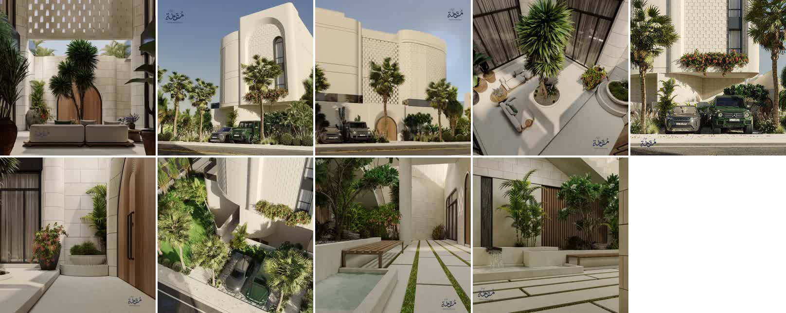
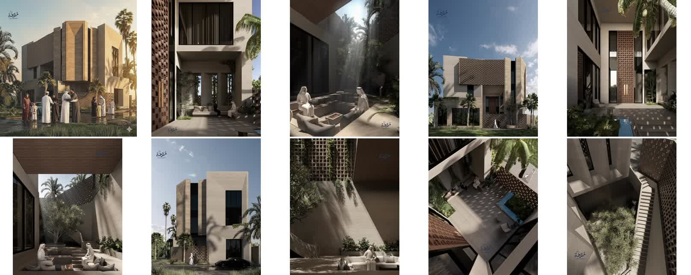
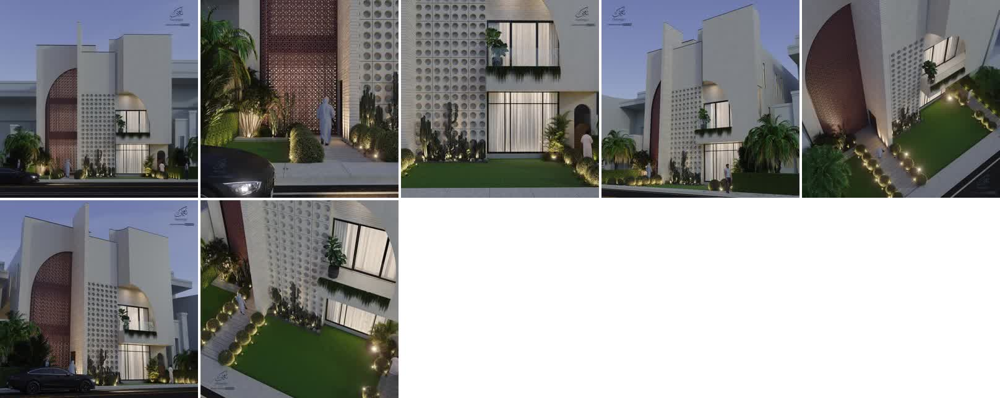
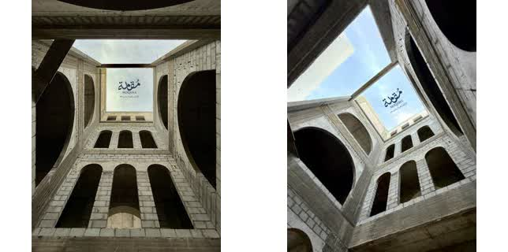
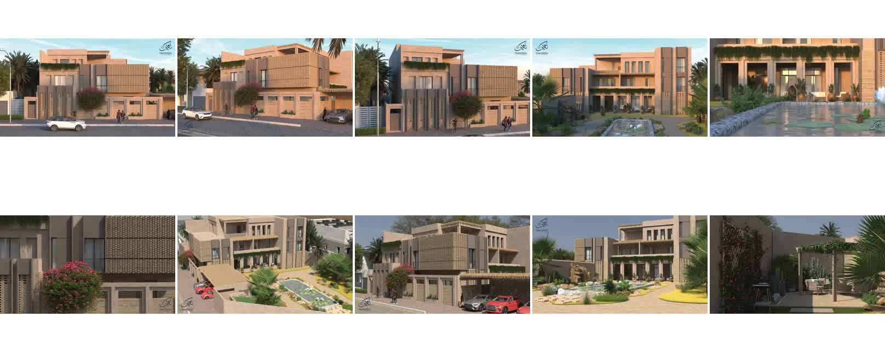
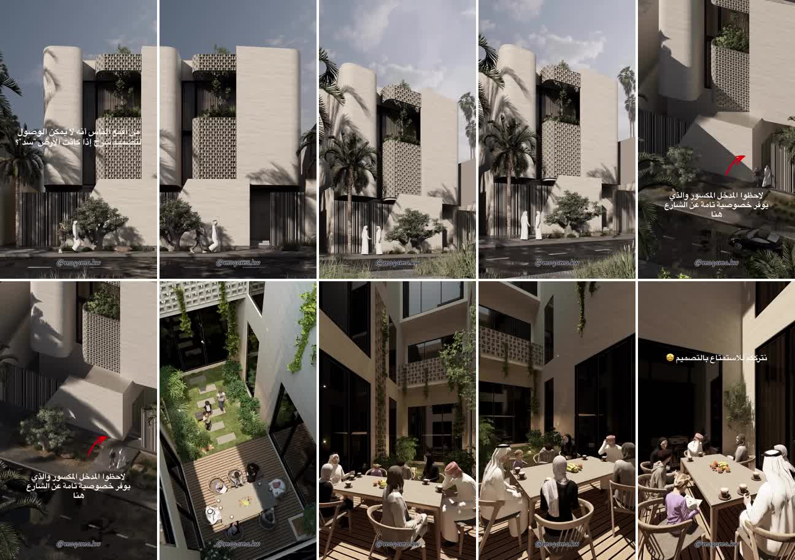
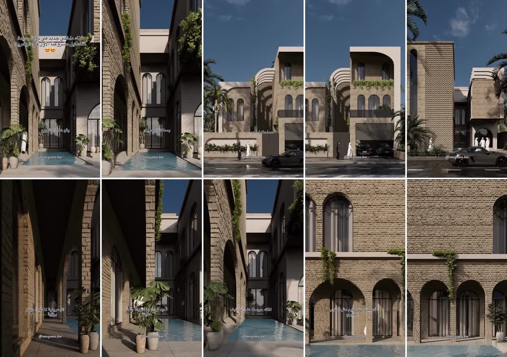
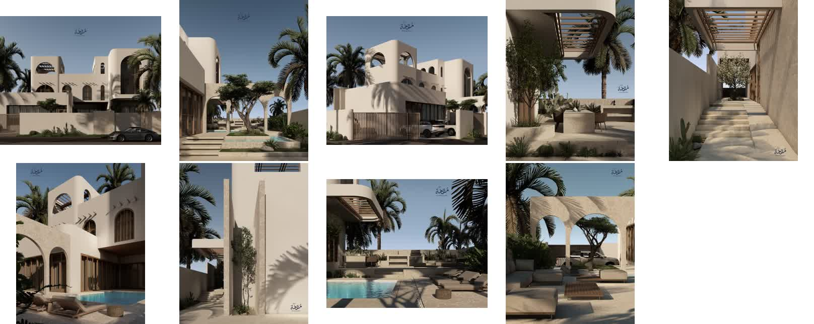
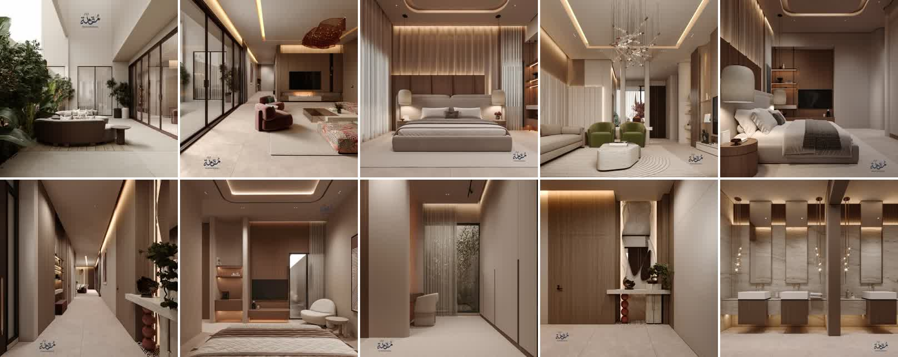
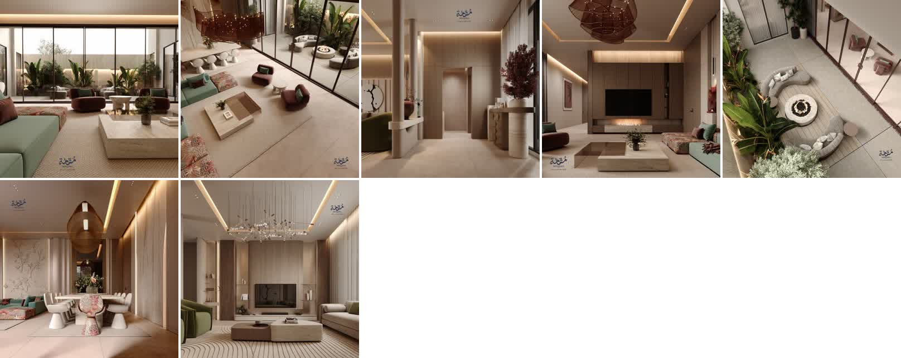
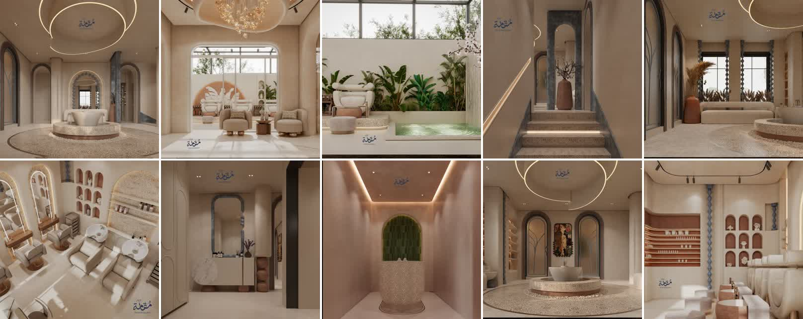
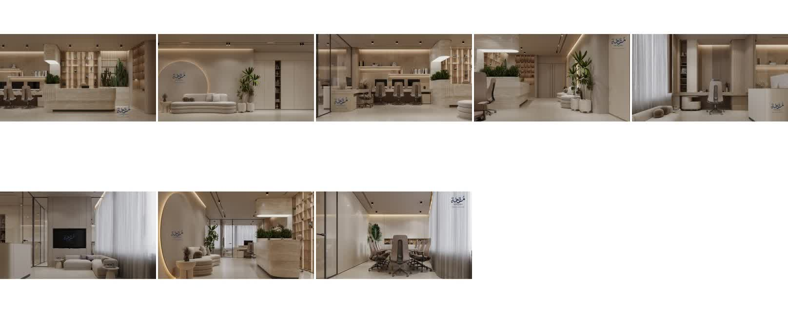

## How pulling works here
- Instagram profile pages cannot be listed without a login; the user sends individual post links instead.
- `yt-dlp --ignore-no-formats-error -J <url>` gives caption, stats and media links (photo posts too); videos via `yt-dlp -o ID.%(ext)s <url>`. For photos, the last listed thumbnail is the full uncropped image. Logged-out requests fail at random; retry with ~10–30 s gaps.
- Cloud environment "MyVerusCliMining" allows: www.instagram.com, i.instagram.com, scontent.cdninstagram.com, scontent-ord5-1/-2.cdninstagram.com, www.khammash.com, khammash.com.
